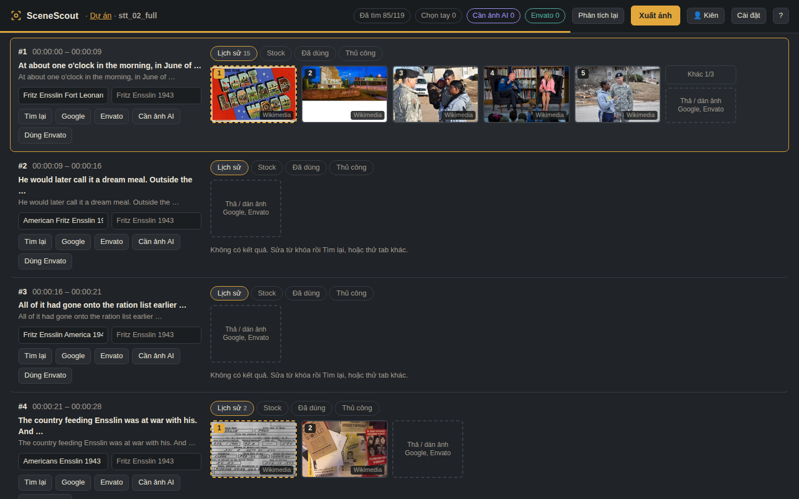

# SceneScout

**Find the right picture for every line of your script.**

SceneScout reads a narration script (SRT), splits it into 4–8 second shots, writes a shot description and search keywords for each one, searches photo archives and stock libraries, and lets an editor pick one image per shot with the keyboard. One click exports every file named by its timecode, ready to drop on the timeline.

Built for documentary and history channels; works for any narrated video.



## What it does

| | |
|---|---|
| **Reads the script** | SRT (recommended), CSV keyword lists, or plain text. Long subtitle cues are split at sentence ends; the first minute gets shorter shots. |
| **Writes keywords** | *Quick* mode works offline and free. *AI* mode understands context ("he" → the right person, the right year and side) using the provider of your choice. |
| **Searches many sources** | Wikimedia Commons, Library of Congress, Openverse (no key) · Pexels, Pixabay, Unsplash photos and videos (free keys) · your own library of previously used images · Google Images and Envato by drag-and-drop or paste. |
| **Fast picking** | Five candidates per shot, keyboard 1–5 to pick and move on, a sensible default that avoids repeating the previous shot's image. |
| **Exports** | `0012_00-01-23.jpg` style names, a list of shots that need AI art or Envato footage, `credits.csv` with source and license for every file, and a manifest. |
| **Builds the timeline** | One MP4 with every shot at its SRT time (drop it in CapCut or any editor at 0:00), plus FCPXML for DaVinci Resolve / Final Cut and XML for Premiere Pro. Optional voice-over, gentle zoom, blurred 16:9 fill, and labelled placeholders for missing shots. |
| **Remembers** | Projects save automatically. Several people can share one computer with separate profiles. Everything you export goes into a shared library you can reuse in later videos. |

## AI providers

Add one or more in **Settings → AI**. They are tried in order: if the first one fails or hits a rate limit, SceneScout moves on to the next.

| Provider | Notes |
|---|---|
| OpenAI (ChatGPT) | paid API |
| Claude (Anthropic) | paid API |
| Gemini (Google) | has a free tier with rate limits |
| DeepSeek | low cost |
| Groq | free tier, very fast, open models |
| OpenRouter | many models; some free (`:free` suffix) |
| Ollama / LM Studio | runs on your own computer, free, offline |
| Any OpenAI-compatible API | set a custom base URL |

A 30-minute script needs about 8–10 AI calls (one context pass, then rows in batches of 40), which fits comfortably inside free tiers. Rows the AI cannot handle fall back to Quick mode instead of failing the whole job. Free-tier terms change often; check each provider's page.

**Your keys stay on your computer.** They are stored in your local profile, never in this repository and never sent anywhere except to the provider you chose.

## Image sources and licenses

SceneScout shows where every image comes from and writes `credits.csv` on export, but **you** are responsible for checking that each image can be used in your video. Wikimedia and Library of Congress items carry their own rights statements; stock sites have their own licenses; images dragged in from Google are usually copyrighted. Envato Elements has no public search API, so the Envato button opens the Envato site with your keyword and you drag your pick back in.

## Download

Get the latest app from the **[Releases](../../releases)** page. No Python needed.

| System | File | First launch |
|---|---|---|
| macOS (Apple Silicon) | `SceneScout-mac-apple-silicon.dmg` | Open the .dmg, drag SceneScout to Applications. The app is not signed by Apple yet, so the first time: open it, then go to **System Settings → Privacy & Security → Open Anyway**. Or run once in Terminal: `xattr -dr com.apple.quarantine /Applications/SceneScout.app` |
| Windows 10/11 | `SceneScout-windows.zip` | Unzip, open the folder, double-click `SceneScout.exe`. If Windows shows "Windows protected your PC", click **More info → Run anyway**. |

The app opens in its own window. Google, Envato and the AI chat sites open in your normal browser; drag images from there into the SceneScout window, or use **Open in browser** at the top if you prefer working in one browser.

## Quick start (from source)

Requires Python 3.9+. Video export uses ffmpeg, installed automatically with the requirements.

```bash
git clone https://github.com/<your-account>/SceneScout.git
cd SceneScout
pip install -r requirements.txt
python run.py
```

Or double-click `start-windows.bat` / `start-mac.command` (first run sets up everything automatically). The app opens in your browser at `http://127.0.0.1:8765` and only listens on your own computer.

On macOS, if the `.command` file is blocked, run once in Terminal: `xattr -dr com.apple.quarantine /path/to/SceneScout`.

## Keyboard

| Key | Action |
|---|---|
| 1–5 | pick an image and go to the next shot |
| ↓ / Enter, ↑ | next / previous shot |
| N | next five candidates |
| T | switch tab: History → Stock → Used → Manual |
| Space | preview large |
| G / V | open Google Images / Envato with the shot's keyword |
| Ctrl+V | paste an image or image link into the current shot |
| A / E | mark "needs AI image" / "use Envato" |
| R | edit keyword |

## Where data lives

| | Windows | macOS |
|---|---|---|
| Profiles, projects, library | `%APPDATA%\SceneScout` | `~/Library/Application Support/SceneScout` |
| Exports (default) | `Documents\SceneScout\exports` | `~/Documents/SceneScout/exports` |

## Roadmap

- [x] 2.0 alpha: profiles, projects, built-in analysis with multi-provider AI, modular sources, shared library
- [x] Timeline export: MP4 aligned to the SRT, FCPXML (DaVinci Resolve / Final Cut), XML (Premiere Pro)
- [ ] CapCut project export (experimental)
- [ ] On-screen text cards, pre-export checks (duplicates, low resolution, risky sources)
- [x] Desktop apps for macOS and Windows built by GitHub Actions
- [ ] Signed and notarized builds (no security prompts on first launch)
- [ ] English interface
- [ ] Shot-list import from a visual brief

## Building the apps

GitHub builds them for you: **Actions → Build apps → Run workflow** (files appear under *Artifacts*), or publish a Release with a tag such as `v3.0.0` and the apps are attached to it automatically.

To build on your own machine:

```bash
pip install -r requirements.txt -r requirements-app.txt
pyinstaller SceneScout.spec --noconfirm     # -> dist/SceneScout.app or dist/SceneScout/SceneScout.exe
```

## Development

```bash
python -m pytest -q        # or: python tests/test_core.py
```

Project layout: `scenescout/` (server, analysis, sources, export), `scenescout/static/` (UI, no build step), `tests/`.

## License

MIT. See [LICENSE](LICENSE).
